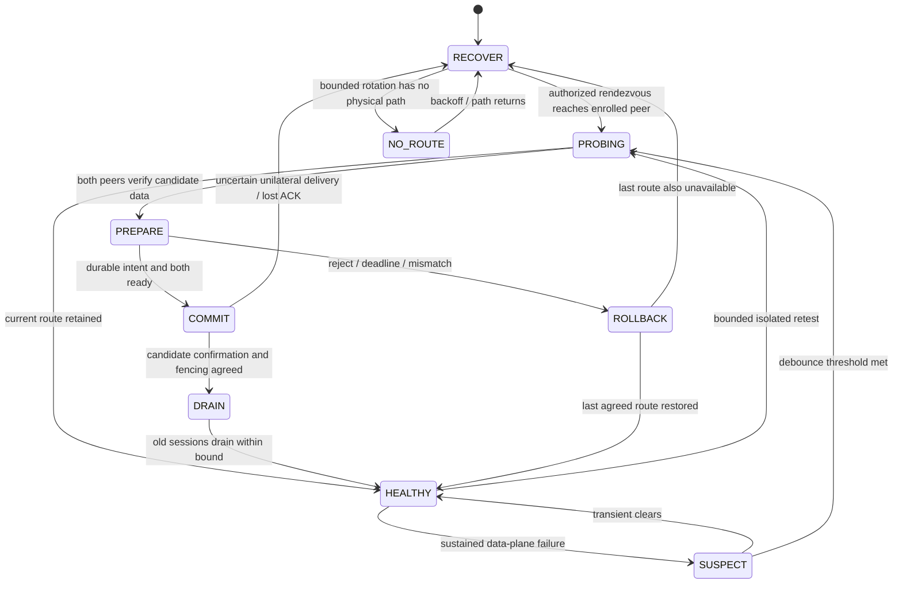

# Native Wat ICMP and peer coordination: source audit and decision record

Audit date: 2026-10-13. Native stream forwarding and peer coordination are
implemented locally and passed the documented local acceptance checks. This
is not a deployment approval or a WAN availability guarantee. Exact measured
evidence, retained failures and unverified environments belong in
[`waticmp-verification.md`](waticmp-verification.md).

## Verified workspace and provenance

- Target: `E:/P_OX/back`, Go module `github.com/backpack/backpack`.
- FullPack HEAD: `132467bfdfb2698d74ada2992413e75bfccbfbd3`.
- Feature branch: `fullpack/waticmp-coordination`. Existing FullPack naming,
  CLI/web parity, HTTPS validation and installer security changes were already
  uncommitted and must be preserved. No commits, fetch, push or deployment
  occurred during the implementation audit; subsequent source publication
  follows the operator's separate GitHub push authorization.
- Read-only reference: `E:/P_OX/back/11/WatTunnel`, module
  `github.com/JohnWatsoon/WatTunnel`, `wat.Version = "2.4.8"`.
- The reference has **no independent Git checkout**. `git -C` finds the parent
  FullPack repository; its SHA must not be presented as a WatTunnel SHA.
- Reference tree fingerprint: SHA256
  `b02cf1a38a42649f8066ca14573d5a98028e94ccf7e676460979808b5b7cf7a2`.
  Computed over 79 files in Python's sorted Windows `Path` order, concatenating each UTF-8
  `path + NUL + file SHA256 + LF`. Hashes use original bytes, including CRLF.
  The inventory and baseline source diff are saved outside the repository in
  the local audit directory. Upstream modification status cannot be inferred
  from this archive. The snapshot itself is the authoritative reference.
- Local reference LICENSE: MIT, `Copyright (c) 2026 Amirreza`. Any adapted
  portions must retain that notice and the complete MIT grant/disclaimer.
  Existing AGPL-3.0 LICENSE, NOTICE and TRADEMARK stay intact. Add a separate
  modified-code inventory and third-party license; do not imply endorsement.
- `/11/WatTunnel/` is ignored. Formatting checks prune all of `11`; Go package
  traversal remains in the target module. `tools/package-release.sh` packages
  the executable, original project legal documents, and the adapted engine's
  MIT license/source inventory explicitly; it never archives the checkout.
  Standalone source copies used for builds/tests exclude `11` and `.git`.

## Observed FullPack integration seams

| Concern | Actual source and behavior |
|---|---|
| Reverse registry | `config/config.go`, `config/fallback.go:IsReverseTransport`, `cmd/validate.go:checkEngine`; TCP, TCPMUX, STEALTH, WS/WSS, WSMUX/WSSMUX, UDP, KCP, QUIC, XDI and PCK factories in `internal/server/server.go:startTransport` and `internal/client/client.go:startTransport` |
| HTTPS | Naive/XHTTP/REALITY helpers bridge into the private reverse TCP listener; native Wat ICMP must not use helpers or spawn wattun |
| Existing xDi | `internal/utils/network` ICMP packet layer beneath KCP; KCP and smux/session pool semantics remain unchanged. Wizard exposes xDi under Direct. Its existence in reverse engine factories does not establish safe multiclient reverse setup support |
| Raw TCP / spoof / SNI | PCK builds TCP packets; Direct `internal/tunnel/l3` has separate UDP/QUIC/PCK/xDi/spoof/SNI datagram carriers. Legacy `internal/tunnel/direct` is a different layer-4 engine |
| Stream control | `internal/controlwire/controlwire.go:Link` carries one-byte bounded signals. It is not a versioned transport negotiation protocol. Never inject arbitrary JSON into existing one-byte streams |
| Reverse port owner | `internal/server/transport/forward.go:portForwarder` binds user TCP sockets and optional UDP flows; queues and listeners belong to a transport generation. `pairing.go`, `listeners.go`, `lifecycle.go` manage admission, release and restart |
| QUIC adapter seam | `quicGen`, `quicClaim`, `seatClient`, `acceptStream`, `forwarder`, `handleLoop`; one authenticated carrier connection has control plus pooled data streams, without redundant smux |
| Client seam | QUIC `channelDialer`, `poolMaintainer`, `control`, `tunnelDialer`, shared `relayStream` and `backendOpts`; preserve UDP-flow framing, metrics, cancellation and limits |
| Legacy fallback | `internal/tunnel/chain/chain.go:Run`, `attempt`, `hold`: one candidate at a time, accepting side dwells and dialing side sweeps faster. No negotiated selection and no user-session migration. Leave unchanged with Auto off |
| Address failover | Client `network.Endpoints` chooses remote addresses, optionally balances or steers by health. Address steering and transport selection must have distinct owners |
| Connection Test | `internal/manage/conntest.go` creates real temporary paired engines and verifies echo/stability; `conntestspeed.go:ctSpeed`, `ctServeSpeedOrEcho` measures useful directional data. Option 0 uses this. It already has a separate authenticated test coordinator and temporary endpoints; unattended Auto must not require fresh interactive links or expose that coordinator |
| Link Test | Management route diagnostics; TCP reachability is not a transport data-path PASS |
| Config and enrollment | `internal/manage/tunnelspec`, `sharelink.go`, `reversesetup.go`, `linkapply.go`, `peerform.go`, CLI and web API. Preserve existing `backpack://` links and secrets on partial edits |
| Fleet / supervision | `internal/control`, `internal/node`, management health/watchdog, monitor/systemd and enginectl. Existing fleet operations are not permission to add a remote shell or a competing Auto watchdog |
| Product integration | CLI transport groups and web forms/options, status and metrics, source installer, update/backup/restore, release workflow and Makefile; FullPack namespaces remain in force |

## WatTunnel source audit

`wat/io.go` defines `PacketIO.Send/Recv/SetPeer/Close`, optional profiling and
batch APIs. `icmp_linux.go` opens a raw IPv4 socket, applies classic BPF for the
ICMP type and a key-derived range of 256 identifiers, builds checksums and lanes,
and supports `NewICMPIOReverse`. Raw sockets are not exclusive: unrelated sockets
can receive copies, ranges can collide and the kernel can echo request payloads.
Type/identifier filtering alone is not authenticated peer or tunnel demux.

`session.go:NewSession/OpenStream/Accept`, `stream.go`, `wire.go`, `ranges.go`,
`sched.go`, `cc.go` and `fec.go` implement ordered streams, selective ACKs,
loss repair, flow control, delay pacing, interactive-first and per-group bulk
scheduling, optional parity and datagrams. Streams provide `CloseWrite` and
`Reset`, but do not implement `net.Conn` deadlines. An adapter must implement
real read/write deadline wakeups rather than returning success from no-op
deadline methods. Only the Wat client opens streams; this matters when mapping
FullPack's Kharej-originating control/data pool.

`server.go` authenticates a first packet before admitting a random SID, then
creates session inboxes; bounds are 32 sessions, 8192 queued packets per session
and 8192 streams. Stream base windows are 4 MiB and may grow to 16 MiB each.
These are not conservative defaults for a two-vCPU FullPack deployment.
`datagram.go` has bounded lossy datagram queues; application UDP framing is
independent from ICMP outer packets. `batch_linux.go` uses x/net batching.

Security findings to resolve in adapted code:

1. `sessionAEAD` derives a key from PSK and SID; direction occupies the high
   packet-number bit. A restarted server initializes its counter from wall
   time (`UnixMicro`). Clock rollback or restored process/config snapshots do
   not prove nonce uniqueness for an already used SID/key. Require fresh
   bilateral cryptographic randomness before each new session; do not claim
   that wall time is a durable epoch or a secure source of uniqueness.
2. `stream.go:killStream` subtracts `winExtra` twice. Retirement accounting
   needs a regression test before porting tuned receive-window behavior.
3. Admission/lane filtering must be per enrolled identity, with bounded work
   before authentication. Source IP alone is not identity.
4. Authenticated frame offsets, ACK ranges and counters need checked arithmetic
   and fuzz tests; resource limits must include tombstones/control queues and
   out-of-order storage, not only active streams.

The manager is **not** a reusable peer coordinator: `auto-test`, `auto_retest`,
`auto_watch` and `auto_write_reverse` in `wattun-manager` test temporary processes,
learn Iran's address through stats or manual `auto-ip`, write companion configs,
and restart services. It can alter kernel echo-reply settings. None of those
side effects or companion processes belong in the native FullPack solution.
Reference benchmarks are reference measurements, not FullPack results.

## Direction and support decisions

Application traffic always enters Iran and reaches a configured Kharej backend.
The implemented adapter targets the **reverse stream engine**, independent of
which endpoint emits ICMP requests. Direct/L3 Wat and Auto are refused by
validation and omitted from Direct setup choices.

| Mode | Iran endpoint | Kharej endpoint | Required bootstrap |
|---|---|---|---|
| Ordinary reverse TCP/WSS/KCP/QUIC | Accepts carrier, owns forwarded ports | Dials Iran and opens control/data streams | Existing peer link |
| Wat normal ICMP | Emits Echo Requests, accepts Wat streams | Emits Echo Replies, opens Wat streams | Both explicit IPv4 hints and authenticated enrollment |
| Wat reverse ICMP | Emits Echo Replies, accepts Wat streams | Emits Echo Requests, opens Wat streams | Explicit Iran IPv4; no successful Direct connection prerequisite |
| Existing Direct L3 | Direct datagram/TUN engine | Direct datagram/TUN engine | Existing Direct link; unchanged |
| Wat Direct L3 | UNSUPPORTED until independently implemented/tested | UNSUPPORTED | UI/config must refuse it |

Wat session roles for the reverse stream adapter are Iran=Wat server and
Kharej=Wat client. Its raw ICMP direction flag therefore differs from
WatTunnel's application-role example. User labels must describe packet direction
explicitly, never infer it from server/client words.

## Implemented coordinator and durable safety model

`internal/tunnel/peerauto` owns one opted-in pair. `cmd/cmd.go` selects this
owner only when `[auto].enabled=true`; existing manual engines and
`internal/tunnel/chain` otherwise keep their previous ownership. Auto rejects
legacy carrier/address fallback, helper-based carriers and competing address
steering. The management watchdog does not restart an Auto tunnel to select a
carrier. There is no new public management port.

The implementation uses Iran as deterministic authority, bound
to stable enrolled tunnel/peer IDs and role, never IP or wall-clock alignment.
Enrollment includes versioned candidate/direction policy and explicitly allowed
endpoints on both peers. No extra public management listener, shell or SSH.
Capabilities, probes, switch transactions and recovery travel in a separately
typed, authenticated carrier stream. Require bilateral fresh session challenges,
separate control/probe/transport key domains, bounded frames and request rates.

`router.go` maintains exactly one user-facing port owner for an opted-in tunnel.
Candidate listeners and test responders have no user-port bind. Accepting-side
data endpoints may coexist only on approved compatible addresses/ports. Existing
manual engines retain their generation behavior. A candidate unable to reserve
its endpoint is unavailable; a healthy production route is not stopped for a
benchmark without an explicit maintenance policy.



`wire.go` implements protocol version 1. HELLO/CAPABILITIES and STATE_SYNC
authenticate the carrier binding, immutable manifest and fresh bilateral
challenges; subsequent bounded JSON frames have HMAC, strict consecutive
sequence numbers and both incarnation/peer identities. PROBE_OFFER/READY/START/
RESULT, PREPARE_SWITCH, READY/REJECT, COMMIT/COMMIT_ACK, ABORT and STATUS drive
the actual implementation. DRAIN and RECOVER are recognized typed semantics;
old-flow draining and reconciliation are local lifecycle operations, not a
second remote command runner. Frames are at most 4096 bytes and reject unknown
fields or trailing values. Duplicate PREPARE/COMMIT is idempotent only for the
same live transaction; stale or foreign proposals are refused.

`store.go` persists generation/intent/last-good/switch budget to a private
regular file, with exclusive no-follow nonblocking flock, atomic rename, file
fsync and directory fsync. Startup increments generation and never restores
active flow authority from disk. Fresh authenticated incarnation prevents nonce reuse
after snapshot restoration; a surviving peer's larger generation fences stale
state. If both peers restore old snapshots, do not claim absolute historical
monotonicity without an external trusted monotonic store. Fresh bilateral
incarnation and reconciliation still must prevent old packets becoming current.

A partition cannot make two-host COMMIT atomic. Until candidate confirmation and
fencing conditions are verified, do not route new production connections into
an uncertain generation. Retain the last agreed route when safe; uncertain
participants enter bounded reconciliation. Existing TCP sessions can drain or
disconnect; arbitrary TCP migration and zero-loss handover are not promised.

Iran opens only manifest-approved passive endpoints; Kharej independently
reconnects authorized candidates with bounded retry/backoff. Wat uses explicit
addresses and packet direction. These endpoints exist before a failure, so
recovery does not wait for messages over the failed carrier, clock-aligned
windows or successful Direct discovery. Stale incarnation takeover is fenced;
reconciliation requires a fresh authenticated session and a higher agreed
generation. Eventual progress assumes a reachable candidate, enough runtime,
finite handshakes, available resources and fair retries. Timing from one fixture
is not an unconditional network recovery bound.
Offline remote hosts, no reachable addresses, bidirectional firewall/NAT blocks
and total network cuts yield NO_ROUTE, not fictitious healing.

## Auto policy and compatibility

Default off; `BACKPACK_DISABLE_AUTO=1` and `BACKPACK_DISABLE_WATICMP=1` refuse
the corresponding feature at startup. `[auto].enabled`, candidate `disabled`,
observe-only, manual lock, test-now/status/history provide scoped controls.
The original five adapters remain supported. The approved completion now adds
the remaining Reverse carriers, explicit Direct initiation for all eighteen
registry choices and the six datagram L3 carriers. See
[Auto carrier completion](auto-carrier-completion.md) for the current matrix,
helper identities, local edits and packet security. Legacy weak carriers gain
authenticated Auto wrappers; `allow_plaintext_fallback=true` is still refused.
Default security floor excludes plaintext or unauthenticated candidates even
if faster. Candidate eligibility requires
both-peer support, identity, permissions, direction, resources and completed
bidirectional authenticated data exchange; a port connection never passes.
Old peers retain legacy/manual behavior and must be rejected before coordinated
selection. Wat wire is distinct from xDi and standalone wattun.

Probe budgets are lower priority than production and use bounded fixed peer-side
responders, separate transactions/session IDs and integrity-checked bytes.
Collect repeated useful throughput and interactive RTT samples, confidence,
failure reason and resource pressure. Healthy idle, local CPU pressure, slow
backend/users and network loss must be distinguished. Require debounce,
quarantine, jittered backoff, cooldown, minimum dwell, hysteresis and a switch
budget. Severe degradation switching requires explicit policy. No config rewrite
on probe failure; no competing monitor/systemd restart authority.

Defaults: 600 s bulk retest with jitter, 300 s optional cross-carrier cooldown,
600 s degradation dwell, three actual failed health probes and two optional
changes/hour. The later approved no-route recovery policy uses a separate
five-second gate with the shared durable twelve-commit hourly ceiling; see
`auto-policy-review.md`. Small liveness checks run separately. Severe-degradation policy
requires three sustained low scores below 40% of the initial three-sample
median and an alternative at least 1.5 times better, after dwell/cooldown/budget.
The reachable-degradation case passed in two Linux namespaces after repairing
initial and changed-RTT loss timing; see the verification ledger for limits.
Observe-only allows initial/last-good same-carrier recovery but suppresses
automatic cross-carrier changes. Runtime actions are local until restart;
persist approved shared policy by re-enrolling both peers.

Fresh probes reuse `internal/tunnel/probe` byte-integrity exchange from
Connection Test: three 512-byte exchanges and a 32 KiB exchange, separately
authenticated transport/session/key and matching digest confirmation on both
the child and original control streams. The application cap is 128,000 B/s,
native probe paced-packet ceiling 256,000 B/s, session lifetime 15 s, one authority probe
per pair, two per process and at least 1 s between starts. Local RSS/CPU/user
pressure or exhausted slots is SKIPPED, not a failed path. Throughput scores
are capped conservative round-trip directional measurements. The latest paced
bulk timeout adjustment from 4 s to 8 s passed the reachable-degradation rerun; legacy interactive
Connection Test remains at 4 s.

## Native engine invariants and implementation paths

- `internal/tunnel/waticmp/{conn,pmtu,capability_linux}.go` implements the
  enrolled envelope/handshake, raw demux, capability validation and bounded I/O.
  A key-derived ICMP identifier/type filter is followed by source, identity,
  session and authenticated envelope checks; it is not authentication by IP.
- `engine/ORIGIN.json` pins the exact copied portions and original byte hashes.
  No KCP/smux, standalone manager or wattun subprocess is used for native Wat.
  The Session/Stream engine retains selective ACK, loss repair, pacing and
  interactive/bulk scheduling. Fresh bilateral X25519 randomness plus PSK
  derives a new session key/ID; server packet counters use a distinct direction
  bit rather than wall time. Counter exhaustion closes the session.
- Adapted stream/window arithmetic, bounded ACK delay, parser bounds,
  deadlines, FIN drain, tombstones and joined worker shutdown repair defects
  found in the reference/adapter. AuthDropped and ReplayDropped count actual
  rejected authenticated-engine packets and are exercised by packet injection.
- Fresh sessions allow 1 s for the first RTT sample instead of repeatedly
  retiring packets after 120 ms on a delayed path. A fixed 4,096-entry ring
  retains only retired packet numbers/times (128 KiB/session), permitting an
  authenticated late ACK to adapt to a changed RTT without retaining stream
  buffers or accepting duplicate timing samples. Pacing includes the 24-byte
  native envelope and IPv4/ICMP headers; startup/floor obey a low explicit cap.
  Handshake/PMTU and tiny ACK/control packets have separate bounded budgets;
  MaxBps is a pacer ceiling, not an exact total-interface bandwidth limiter.
- Native limits include 1-8 lanes, 128 streams by default/256 maximum, 128 KiB
  base receive windows with a 16 MiB aggregate growth ceiling, bounded packet
  pools/queues, and default wire cap 1,000,000 B/s. Starting payload is 512
  bytes at MTU 576; authenticated nonce-bound PMTU proof is required before
  increasing it. No host echo sysctl is changed.
- `internal/server/transport/waticmp.go` and
  `internal/client/transport/waticmp.go` use existing reverse control/pool/
  backend paths. TCP half-close and framed UDP are real application traffic.
  Direct GRE/L3 does not reuse this stream adapter.
- New Auto setups explicitly enroll zero/no application connection ceiling;
  the original 64/default and 192/maximum policy remains historical for legacy
  enrollment. Optional positive caps retain bounded queues. There are still
  1-32 enrolled port maps and 1-4 legacy approved candidates. Opt-in pool
  enrollment additionally allows at most 48 approved candidates with four
  measured selected routes; see `quick-auto-setup.md`. Backend selection is a
  mapping index with HMAC/generation/ticket, not an arbitrary peer-supplied
  destination. UDP queues are bounded at four frames/flow with idle expiry.
  Old approved flows drain for at most 30 s; new ones immediately require the
  new generation. Counters describe flow completion/drain/interruption, not
  successful application transactions or seamless TCP migration.

Commit ordering is: authority saves intent and next generation; follower
validates a recent passing probe and saves matching PREPARE intent before
READY; follower saves active commit and installs its fenced route before ACK;
Iran validates ACK, saves commit and activates its route. If ACK delivery or a
durable save is uncertain, Iran fences new traffic, closes the uncertain
candidate and reconciles over pre-enrolled endpoints at a fresh generation.
An initial PREPARE rejection retains the previously agreed route. Existing
TCP flows may finish on the old route or be interrupted by failure/drain expiry.

## Operator integration and safe rollout

Setup Iran / Reverse / Native offers Wat ICMP and Auto separately from xDi.
The web Native family offers the same choices plus **Import an enrolled Kharej
endpoint**. Create the Iran configuration first with both explicit IPv4
addresses (Wat), direction, exact user maps and permitted candidate endpoints.
Start Auto in observe-only mode. Transfer its version-3 `backpack://` setup
link over a trusted out-of-band channel, then use Setup Kharej's selected native
method or `sudo fullpack link apply '<private enrollment link>'`. Shared fields
must match on both upgraded peers. Links contain credentials: HMAC with the
included secret is corruption protection, not proof of a trusted issuer.
No TLS private key, helper executable path or Iran local bind is exported.

Connection Test (CLI option 0) has separate native normal/reverse results.
Both explicit test peer IPv4s are required; otherwise the rows are clearly
SKIPPED. Its legacy interactive joining coordinator still needs its existing
TCP/UDP bootstrap. Unattended Auto has independent pre-enrolled bootstrap in
the candidate's approved Reverse or Direct direction and does not inherit
that joining limitation. Link Test remains
route diagnostics.

On Iran, actual private-IPC operations are:

```sh
fullpack auto status <name> --json
fullpack auto test-now <name> <candidate>
fullpack auto lock <name> <candidate>
fullpack auto unlock <name>
fullpack auto switch <name> <candidate>
fullpack auto observe <name>
fullpack auto resume <name>
fullpack auto disable-carrier <name> <standby-candidate>
fullpack licenses --json
```

The authenticated panel Edit view exposes the same status/scores/history and
write-scoped actions through `/api/tunnel/auto`; Kharej imports use
`/api/tunnel/peer-enrollment`. Unknown/oversized/trailing requests are rejected
and responses omit enrollment secrets. Disabling the active candidate is
refused until another route is confirmed. Changing a shared policy/identity,
candidate set, peer IP or enrollment secret requires a stopped/re-enrolled
pair with a fresh tunnel identity, not unilateral hot editing.

Upgrade both endpoints from customized source with a patched toolchain. Keep
old manual peers/configs working; old binaries do not support version-3 native
enrollment, native Wat wire or Auto negotiation. Protect private copies of
configs, `.auto-state.json` files, original binaries and legal documents before
upgrading. State files/lock inodes are preserved through compatible rename/
restart and never used to revive unauthenticated old flow authority.

For a manual rollback, stop **and disable** the two opted-in services, preserve
their configs and fencing state, then create a separately named manual tunnel
on both ends using a previously supported carrier and a matching legacy setup
link. Release the old Iran user listeners before binding the manual service.
Reverting a binary alone while native/Auto configs remain enabled is unsafe.
To resume Auto, stop the manual service first and restore both matching
enrolled configs with their preserved states; fresh startup reconciliation is
mandatory. Rotate/revoke a compromised enrollment by stopping both old peers
and creating a fresh secret, IDs and trusted link; remove old authorized
listeners only after they have stopped. Disposable systemd installation,
upgrade and compatible local-build rollback passed; the exact tested boundary
is recorded in the verification ledger. Live deployment still requires review
of the actual server configuration.

No additional global firewall rules, sysctls or service capabilities are added
by native code. Linux needs root or CAP_NET_RAW; missing privileges produce an
actionable refusal. The installer retains the patched-Go check and existing
release signature verification. No live server or binary release was changed
during this implementation audit. Source publication is a separately
authorized Git operation against the existing fork.

## Falsifiable gates and validation

G0: baseline tests/race/vet, amd64+arm64 standalone builds, immutable reference
fingerprint, complete source/provenance record. G1: real native Session/Stream
adapter and both ICMP directions, application TCP/UDP, identity/replay/limits,
deadlines and cleanup. G2: real two-peer negotiation, probes, fenced switching,
crash/partition recovery and no-control bootstrap. G3: failure/degradation-driven
coordinated selection and bounded recovery, no flapping or security downgrade.
G4: functional CLI/web/config/link/status/install/rollback and packaging.

Run two isolated Linux peers with raw socket capabilities; verify reverse-only
requests when Iran requests and TCP/UDP Direct are blocked. Test MTU
576/640/700, loss/reorder/duplicates/corruption/asymmetry/rate limits, multiple
identities plus xDi and ping, 100+ streams, slow readers and exhaustion. Test
crashes at every durable transition, missing COMMIT ACK, mismatched versions,
policies/identities, replay and snapshot rollback. Existing tunnels with Auto
off must pass unchanged. Record explicit NOT RUN/NOT VERIFIED for missing tests.

Benchmark adapted Wat ICMP and xDi with identical two-vCPU workload, path and
packet limits. Report security confounders, useful Mbps, p50/p95 RTT, CPU/RSS,
FD/goroutine peaks, ICMP rate/retries and switching/drain losses. Measure small
and medium loads, then stress concurrency as resource limits permit. No reference
WAN number is a measured FullPack result. Validate installer/rollback only in
disposable Linux; no live VPS access is authorized.

## خلاصهٔ فارسی

تکمیل تأییدشدهٔ بعدی، Auto را به هر ۱۸ حامل با آغاز اتصال Reverse یا Direct
و شش حامل دیتاگرامی L3 گسترش می‌دهد. مرجع جاری جزئیات و محدودیت‌ها
`docs/auto-carrier-completion.md` است. ایران همچنان تنها مرجع تصمیم سوئیچ است؛
هویت جفت، fencing، تأیید TLS و پیش‌فرض خاموش حفظ شده‌اند.

<div dir="rtl">

مرجع محلی WatTunnel نسخهٔ ۲٫۴٫۸ است و مخزن Git جدا ندارد؛ نسخهٔ دقیق آن با هش
فایل‌ها ثبت شده است. موتور Wat ICMP مستقل از xDi و بدون اجرای برنامهٔ
wattun در FullPack ادغام شده است. جهت درخواست‌های ICMP با نقش کاربردی سرورها یکی
نیست: کاربران همیشه به ایران وصل می‌شوند، ولی درخواست ICMP می‌تواند از هر طرف
شروع شود. قبل از انتخاب خودکار، مالکیت ثابت پورت‌ها، احراز هویت دوطرفه، ثبت
نسل مسیر و بازیابی بدون کانال فعال در آزمایش‌های واقعیِ محیط ایزوله تأیید شدند.
مسیرهای بومی TCP/UDP و هماهنگی دو سرور پیاده شده‌اند و تست افت شدید سرعت، نصب،
بازگشت نسخه و کیفیت نهایی نیز موفق بودند. نتایج و محدودیت‌های دقیق در سند
تأیید ثبت شده‌اند؛ نتیجهٔ آزمایش محلی به معنی تأیید شبکهٔ واقعی ایران و خارج نیست.

</div>

*Last verified against FullPack v1.9.0 (source review and local acceptance with documented limits, 2026-10-13).*

*Last verified against FullPack v1.9.2 (documentation compatibility review, 2026-10-14; historical measurements and pending gates retain their recorded scope).*

*Last verified against FullPack v1.9.3 (source/documentation compatibility review, 2026-10-15; original measurements, earlier release results and pending acceptance gates retain their recorded dates and scope).*

*Last verified against FullPack v1.9.4-beta.2 (source/documentation compatibility review, 2026-10-15; historical measurements retain their dates and scope; release, deployment, WAN and soak gates require their separately recorded evidence).*

*Last verified against FullPack v1.9.4-beta.7 (source review of bounded Auto receive/transmit isolation, 2026-10-16; historical measurements keep their scope; CI/deployment and soak require separate evidence).*

*Last verified against FullPack v1.9.4-beta.11 (source/documentation compatibility review of local listener preflight, status attribution and explicit backend readiness in the slow-reader fixture, 2026-10-17; original measurements and failed or pending WAN/release/deployment/soak gates retain their separately recorded dates and scope).*
